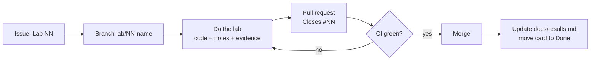

# Learning FinOps with this repo

The repo is the course. Each lab is a **GitHub issue**, you do it on a **branch**, you hand
it in as a **pull request** that the **CI checks**, and the proof stays in `docs/notes/` and
`docs/results.md`. After 14 labs the commit history shows what you learned and when, which
an interviewer can read.



## Set it up once

1. Install the GitHub CLI and sign in: `winget install GitHub.cli`, then `gh auth login`.
2. From the repo folder: `powershell -File scripts/setup-learning-board.ps1`
   It creates 3 milestones (Inform, Optimize, Operate), labels, and one issue per lab from `docs/labs.json`.
3. On GitHub: **Projects → New project → Board**, add all issues. Columns: Todo, Doing, Done.

## Each lab

```powershell
git switch main; git pull
git switch -c lab/04-allocation
# ... do the lab, write docs/notes/04-allocation.md ...
git add -A; git commit -m "Lab 04: allocation and tagging"
git push -u origin lab/04-allocation
gh pr create --fill --body "Closes #4"
```
Merge when the checks are green, then `git switch main; git pull`.

## The 14 labs

| # | Lab | Phase | FinOps capability | FOCP topic |
|---|---|---|---|---|
| 1 | FinOps in my own words | Inform | Education & Enablement | Principles, personas, phases, maturity |
| 2 | Read a bill: FOCUS columns | Inform | Data Ingestion | FOCUS, cost types |
| 3 | Deploy the AWS stack | Inform | Data Ingestion | Tools & services |
| 4 | Allocation and tagging | Inform | Allocation | Showback, chargeback, shared cost |
| 5 | Reporting for each persona | Inform | Reporting & Analytics | Personas |
| 6 | Anomaly management | Inform | Anomaly Management | Detection and response |
| 7 | Waste: orphaned resources | Optimize | Workload Optimization | Usage optimization |
| 8 | Right-sizing compute | Optimize | Workload Optimization | Right-sizing |
| 9 | Rate optimization: commitments | Optimize | Rate Optimization | RIs, Savings Plans, coverage, breakeven |
| 10 | Kubernetes cost allocation | Optimize | Allocation + Workload Optimization | Containers, idle and shared cost |
| 11 | AI token management | Optimize | Unit Economics + Budgeting | Unit economics |
| 12 | Azure side | Optimize | Policy & Governance | Multi-cloud |
| 13 | Forecast, budget and variance | Operate | Forecasting + Budgeting | Forecasting, variance |
| 14 | Run the practice + FOCP exam | Operate | Practice Operations | Operating model, KPIs, maturity |

Full steps and "done when" for each lab are in `docs/labs.json` and in each issue.

## Pace

About 2–3 hours per lab. One lab a week fits around a newborn. Labs 1, 2, 9, 13 and 14 need
no cloud account, so they are the ones to do on low-energy weeks. Labs 1, 2, 4, 9 and 14 cover
most of the FOCP exam topics, so do them first if the exam comes before the rest.

## Rules for a public repo

- Never commit `terraform.tfstate`, `*.tfvars`, real billing exports, or a company cluster snapshot. `.gitignore` blocks the usual ones.
- Hide account IDs in screenshots.
- `docs/results.md` holds only real numbers, each with how you got it. Synthetic demo numbers never go there.
