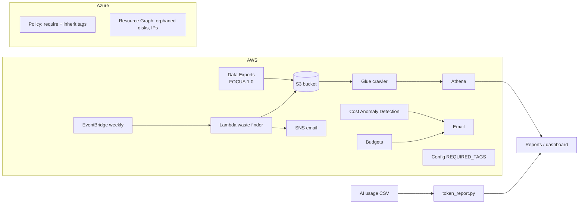

# FinOps Lab: AWS + Azure cost visibility, governance and AI token spend

A small, working FinOps platform you can run in your own account. It covers the
day-to-day jobs of a FinOps engineer. **New here? Start with [LEARNING.md](LEARNING.md)**: 14 labs run as GitHub issues and pull requests.

| Job | What is in this repo |
|---|---|
| **Visibility** | FOCUS billing export → S3 → Glue → Athena, plus 6 ready SQL queries |
| **Allocation and tagging** | Tag taxonomy, untagged-cost query, AWS Config `REQUIRED_TAGS` rule, Azure Policy that requires and inherits tags |
| **Rate optimization** | Savings Plan / reservation coverage and savings query |
| **Waste elimination** | Weekly Lambda that finds unattached EBS volumes, old snapshots and idle Elastic IPs, prices them, and deletes only what a human approved |
| **Anomaly detection** | AWS Cost Anomaly Detection + budget alerts (Terraform) and a SQL version that explains the idea |
| **Forecast and variance** | Month-over-month variance query and the monthly rhythm in `docs/finops-rhythm.md` |
| **AI token management** | Token spend by team/app/model, budget forecast, cache-hit and model-mix advice |
| **Kubernetes** | Pod-level cost allocation by team, idle and shared cost, over-requested pods, Kyverno label/request policies, OpenCost and EKS split cost allocation |



## Try it in 1 minute (no cloud account)

```bash
make setup && source .venv/bin/activate   # macOS / Linux, once
make demo     # synthetic AWS + Azure billing data -> reports/finops-report.html
make tokens   # synthetic AI usage -> reports/ai-token-report.md
make k8s      # Kubernetes allocation on a synthetic cluster -> reports/k8s-allocation.md
make test     # unit tests
```

No `make` on Windows? Run the same commands from the Makefile directly, e.g. `python demo/run_demo.py`.

The demo uses **synthetic data** (`demo/generate_sample.py`). It runs the same logic as the Athena queries in DuckDB, so you can see the output before touching a real bill.

## Run it on a real account

See [`docs/setup.md`](docs/setup.md). Short version:

```bash
cd terraform/aws
cp terraform.tfvars.example terraform.tfvars   # set owner + alert_email
terraform init && terraform apply
# then create the FOCUS export in the console, pointing at the bucket output (prefix: focus)
```

Running cost is small: S3, Athena and Lambda stay in cents; the daily Glue crawler is the largest item (about a dollar or two a month). Cost Anomaly Detection is free. The Config rule is off by default because Config bills per evaluation.

## Repo map

```
demo/                 synthetic data + DuckDB demo report
sql/athena/           queries for the FOCUS table (allocation, tags, coverage, variance, anomalies)
terraform/aws/        bucket, Glue, Athena, budgets, anomaly detection, Config rule, waste finder
terraform/azure/      Azure Policy: require + inherit tags
azure/                Resource Graph queries for orphaned resources
lambda/waste_finder/  waste finder code + unit tests
ai-tokens/            token spend report, example prices and budgets
k8s/                  Kubernetes allocation, snapshot scripts, Kyverno policies, OpenCost notes
scripts/              creates the learning board (milestones, labels, lab issues)
.github/              CI, issue and PR templates
docs/                 setup, FinOps rhythm, labs.json, notes/, results log
```

## Results

Real results from my own account go in [`docs/results.md`](docs/results.md). The demo numbers are synthetic and are not results.
