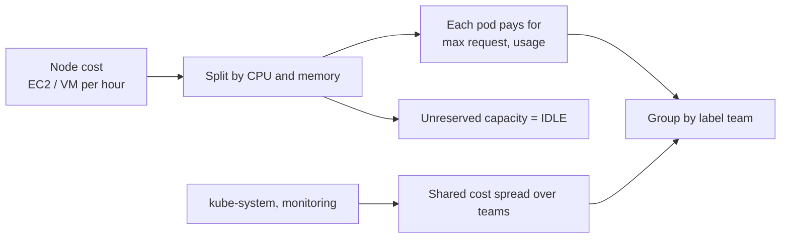

# Kubernetes FinOps

A cloud bill shows **nodes** (EC2 instances, Azure VMs). Teams run **pods**. Kubernetes
FinOps is the work of turning the first into the second, then cutting what nobody uses.

## The four numbers to know for any cluster

| Number | Meaning | Who fixes it |
|---|---|---|
| **Cost per team** | Direct pod cost + share of system cost | Each team |
| **Idle %** | Node capacity no pod requested | Platform team: bin-packing, node size, Karpenter consolidation |
| **Request efficiency** | Used ÷ requested CPU and memory | App teams: lower requests that are far above use |
| **Unlabeled cost** | Pods with no `team` label | Everyone: Kyverno policy stops new ones |

## In this folder

| File | What it does |
|---|---|
| `allocate.py` | Allocates a cluster snapshot to teams, reports idle and over-requested pods. `python k8s/allocate.py` runs on synthetic data. |
| `collect_snapshot.ps1` / `.sh` | Read-only `kubectl get` commands that capture a real cluster for `allocate.py --kubectl-dir` |
| `policies/require-cost-labels.yaml` | Kyverno: every pod needs `team`, `env`, `cost-center` labels |
| `policies/require-requests.yaml` | Kyverno: containers need CPU/memory requests and a memory limit |
| `policies/namespace-guardrails.yaml` | ResourceQuota + LimitRange: a per-namespace budget in Kubernetes units |
| `opencost/README.md` | Run OpenCost for continuous allocation, or use EKS split cost allocation data |

## Optimization levers, cheapest first

1. **Right-size requests**: requests far above use waste money on every replica.
2. **Scale to demand**: HPA for pods, Karpenter or Cluster Autoscaler for nodes.
3. **Consolidate nodes**: fewer, better-packed nodes; Karpenter consolidation does it automatically.
4. **Cheaper capacity**: Spot for stateless and batch work, Graviton (arm64) where images support it.
5. **Commitments last**: Savings Plans cover the steady node baseline left after steps 1–4.

## Practising on a real cluster

Only run `collect_snapshot` on a cluster you are allowed to read. It uses `kubectl get` and
the metrics API only, and changes nothing. Do not commit snapshots of a company cluster
to a public repo: pod names and labels can be internal information.
